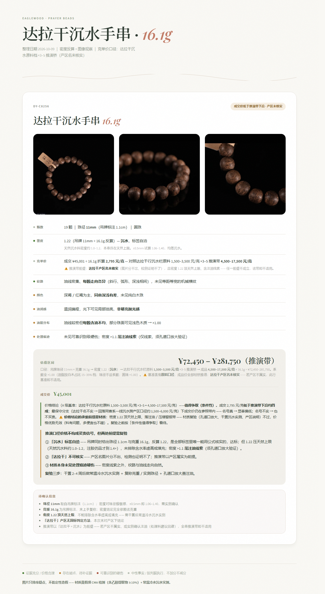
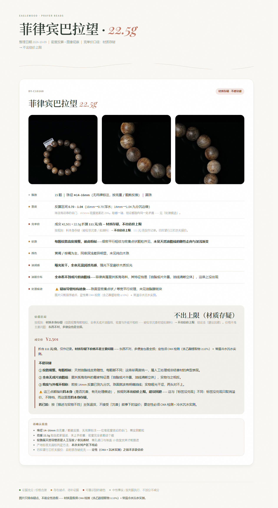

# eaglewood-prayer-beads · 沉香手串看图速判与估价

> Agent Skill —— 由手串照片 + 参数描述，输出料质判断、处理痕迹识别、标签核实与估价结论，并生成一张图文速判 HTML 卡片。

一句话原则：**标签会骗人，克重和纹路不会。**

## 它做什么

输入：手串照片（1 张起，含微距图更好）+ 描述（产地 / 品类 / 珠径 / 颗数 / 克重 / 挂牌价）。

输出：

1. 估价结论（值不值、参照带位置、风险方向）
2. 一张 Botanical / Organic Serif 风格的图文速判卡片（HTML）

## 示例卡片

整页速判卡（截取自实际产出）：





卡片按固定 8 维观察项出条目，每条带状态灯：

- 🟢 绿 = 正向证据（纹路自然、微距三大结构齐全）
- 🟡 黄 = 存在疑点，待补证据
- 🔴 红 = 可靠识别的硬伤
- ⚪ 灰 = 中性事实 / 按判据执行，不加分不减分

## 工作原理

```
照片 + 参数
   │
   ├─ 1. 图像观察 ──── 纹路 / 颜色 / 油润感 / 油脂分布 四维度
   ├─ 2. 密度反算 ──── V = 4/3 π r³（圆珠）；桶珠/鼓珠用 π r² h × 0.85
   ├─ 3. 克单价基准 ── 1.1 产区基准表 → 现查原料价 → ×3–5 推演桥
   ├─ 4. 痕迹与标签 ── 处理痕迹识别（微距可升级）+ 标签可核实性分层
   └─ 5. 定价与结论 ── 系数修正 → 方向性结论 → HTML 卡片
```

核心是**密度反算与图像观察互相交叉验证**：密度告诉该片面的油脂水平，图片告诉密度档是否与外观相容。

## 目录结构

```
eaglewood-prayer-beads/
├── SKILL.md                        # 主文档（工作流六步 + 铁律）
├── references/
│   ├── pricing-model.md            # 密度公式 / 五系数 / 弱基准方向性结论 / 结论分档
│   ├── region-benchmarks.md        # §一 1.1 产区原料价基准表（价格唯一出处）
│   ├── treatment-marks.md          # 处理痕迹判据（外观 + 微距两套）
│   ├── label-verification.md       # 标签可核实性三层分类 + 极度稀缺名号
│   └── image-observation.md        # 看图四维度与能力边界
├── scripts/
│   ├── build_card.py               # density / estimate / diameter / build 四个子命令
│   └── package_skill.py            # 打包分发（目录级排除 + 逐字节回验）
├── assets/                         # 页面模板 / 单卡骨架 / 示例 spec
├── outputs/                        # 卡片产物（运行时生成）
└── docs/                           # README 截图
```

## 快速开始

密度反算（圆珠）：

```bash
python scripts/build_card.py density --weight 11.2 --beads 19 --diameter 11.5
```

估价：

```bash
python scripts/build_card.py estimate --base-price <上限克单价> --weight <克重> \
  --oil <均匀|不均|干涩> --diameter <珠径mm> --shape <形状>
```

生成卡片（spec JSON → HTML）：

```bash
python scripts/build_card.py build --data <spec.json> --out <输出.html>
```

spec JSON 结构见 `assets/example-spec.json`；`build` 会自动复制图片、渲染并校验 div 平衡。

## 定价规则要点

- **基准唯一出处**：`references/region-benchmarks.md` §一 1.1 原料价档位表。表内无价 → 联网现查原料口径价并补表；成品口径不得进表
- **推演桥**：成品克单价 = 原料价 × 3–5（圆珠成品率约 1/4，材料成本即 ~4×）
- **系数**：油脂分布（主导）> 形状（圆珠 > 桶珠 > 鼓珠 > 随形 > 片片珠）；珠径不设系数
- **弱基准方向性结论**：同产区同档基准缺失时不出上限，但参照带按 A/B/C/D 分级仍可出方向性结论（「不构成买贵」「偏向值得争取」），并做最保守分支锚定——假设名号完全不实回落通用口径再算一次
- **参数可信**：用户明确给出的数字（珠径 / 克重 / 颗数）默认视为真实数据直接计算；仅当反算密度跳出天然合理带（约 0.5–1.2）或与图像观察明显矛盾时才提出复核

## 判据红线

- 图片只能排序疑点，不能定性造假；用语是「XX 迹象」，不是「是假货」
- 定性须 CMA 检测（乙醇提取物 ≥10%）+ 常温冷水沉水实测
- 产区名 / 品级名（菩萨棋 / 奇楠 / 软丝…）不可核实 → 不授予溢价，也不降档
- 不跨产区比价、不混用原料价与成品价、区间不写单值
- 吊牌缺产区 / 克重 / 密度是行业常态，不当减分项
- 处理 = 造假：图上看得出的人为干预一律「建议回避」，不出估价上限

## 打包分发

```bash
python scripts/package_skill.py --out <目标.zip>
```

自动排除 `__pycache__` / `outputs` / `.workbuddy`，并做逐字节回验。

## 免责声明

本项目输出为基于照片与参数的参考性判断，不构成鉴定结论，也不构成投资建议。材质定性以 CMA 检测为准。沉香（白木香）为国家二级保护野生植物，交易请遵守 CITES 及所在地区法律法规。
